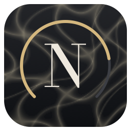

# Noir Synth Studio

A love letter to the sound of cinema: the neon synths of 80s sci-fi noir, the towering brass of the modern
blockbuster, the cool menace of the classic spy thriller, the warmth of epic fantasy and the bittersweet chords
of anime film.

**Noir Synth Studio** is an 80s neo-noir polysynth for LUNA, built around 20 film-score chord progressions, each
paired with a patch made for its mood: rain-slicked city pads and resonant poly brass, epic minor-key brass that
climbs bar by bar, the wide-eyed wonder of a raised fourth, a spy-thriller line sliding through one dark chord,
celesta-bright magic, and suspended drones that never resolve. Hold one key and the progression plays in time
with LUNA, voice-led like a string section, in a window of sunlight on water that ripples with every note.



| | |
|---|---|
| Opens in | LUNA > Add Ons > Windows > **Noir Synth Studio** (while a session is open) |
| Needs | LUNA 3.1.2 or later |
| Maker / id | Noir Lab, `com.noirlab.noir_synth_studio` |
| Showcase category | Create |

## Install

Download `noir-synth-studio.lunaaddon` from the [latest release](../../releases/latest) and open it in LUNA,
or add this repository in LUNA's Add On showcase: LUNA installs the `.lunaaddon` from the latest release and
picks up new releases as updates.

## Playing it

- **Keys**: the on-screen keyboard (C1 to C6, LUNA naming), the computer keys A W S E D F T G Y H U J K O L P ;
  (from C3; Z / X shift the octave), or any MIDI keyboard LUNA sees.
- **Programs**: 25 in all: 5 Signature sounds and 20 Film progressions, each with its own patch. Use the arrows
  beside the name, or click the name for the list.
- **Chords**: with Chords on, each key plays a chord in the chosen Key and Scale (Chords page): type, voicing,
  inversion, strum and an added bass note are all adjustable.
- **Auto** (Film programs): hold one key and the progression plays rooted on it, one chord per Chord Length, at
  LUNA's tempo; while LUNA plays, chord changes land on LUNA's bars. Hold another key to transpose.
  **Keys** mode instead: C D E F G A B pick chord 1, 2, 3... of the progression.
- **Tiles**: play one chord each, and light up with the chord that's sounding.
- **Light**: drifts behind the controls, pulses with each note and drops a ripple above the key you played.
  The **Light** switch turns it off.

## Where the sound goes

- **Window** (default): the synth plays in the Add On's window. It doesn't go through LUNA's mixer, so it can't
  be recorded as audio.
- **LUNA track**: notes go as MIDI to the selected instrument track (arm or monitor it to hear it; record to
  capture the MIDI). The filter sweep is sent as CC 74, and to the instrument's **Cutoff** parameter when it has one.
- **Both**: the two at once.

## Develop

```bash
npm install && npm test
```

```bash
npx ua-builder serve
```

The tests run against the LUNA Builder SDK's mock engine (no LUNA needed). `serve` opens the page at
http://localhost:8790/ against a running LUNA; `npx ua-builder install` links the folder into LUNA's Add Ons, and
`npx ua-builder pack` builds `noir-synth-studio.lunaaddon`.

| File | What it holds |
|---|---|
| `logic.js` | presets, arpeggiator, sweep, chords, the 20 progressions and voice leading, the 25 programs, the chord engine and LUNA output (no DOM; tested) |
| `synth.js` | the Web Audio synth: voices, chorus, delay, reverb, and a compressor running as an audio worklet |
| `light.js` | the light on water and the ripples (a small canvas the browser scales up; 12 fps at rest, 24 while moving) |
| `main.js` | the pages, controls, keyboard, tiles, Auto player, arpeggiator, routing and LUNA connection |
| `index.html` | layout and styles |
| `tests/studio.test.js` | the tests |
| `vendor/luna.global.js` | the LUNA Builder SDK, bundled |

## Changes

**1.0.3**
- New showcase description.

**1.0.2**
- The Add On now always opens with its output on **Window**. It no longer remembers **LUNA track** or **Both**
  between sessions, so a forgotten setting can't layer the window synth with whatever is on the selected track.

**1.0.1**
- Fixed: the filter envelope was being overwritten by the filter sweep, so some patches (Hold The Line, Neon
  Brass and others) swelled and then dropped out while a key was held. Cutoff is now the swept base plus the
  envelope, on separate controls.
- Fixed: every note's start was softened by the browser's built-in compressor. The synth now uses its own
  compressor (threshold -14 dB, ratio 3, 30 dB knee, 3 ms attack, 250 ms release) as an audio worklet.

**1.0.0**
- First release.
